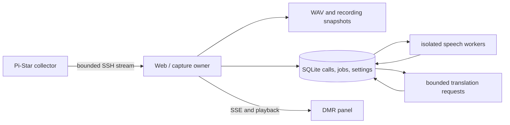

# Architecture and recovery

Starwave uses one application process per DATA_DIR. This keeps the deployment
small and makes ownership explicit; SQLite is the durable queue, not a cache
behind an in-memory broker. Start and stop listening are operator actions.

## Lifecycle

First launch serves HTTP in standby. A successful operator start stores
`listening_requested=true` before creating capture and processing tasks. Stop
stores `false` first, ends SSH capture, finalizes eligible current audio, stops
speech subprocesses, and releases job leases. HTTP and history remain available.
Capture and processing stop together; an accepted HTTP stop keeps finishing even
when the requesting browser disconnects. Read traffic and repeated starts use
separate rate-limit budgets from Stop. Source-generated status versions prevent
older GET/SSE replies from replacing a newer operator control response. Paused
receivers synchronize their final history snapshot without replaying late call
events as ongoing work.

Normal container/service shutdown preserves the choice, so supervised restart
recovers the last explicit operator action.

Expected network failures reconnect with a delay and show degraded state.
Unexpected background-task exits set a fatal supervision event; the main
process shuts down and exits nonzero for Docker/systemd to restart. Model
loading failures preserve jobs and retry rather than failing every recording.
Each speech subprocess uses a bounded JSON pipe, bounded timeouts and explicit
cache paths. It cannot inherit the parent's API/control credentials. Stopping
it terminates and reaps the process, including when native inference is busy.

## Persistence

Calls retain the original JSON layout for existing recordings. Versioned
migrations add jobs and settings, take a verified SQLite backup first, and reject
unknown future schema versions. WAL, full synchronous commits, busy timeout,
parameterized SQL and a data-directory owner lock protect the local database.

Each `(call_id, stage)` job is unique. Claims use immediate transactions and
expiring lease tokens. Completion and the next stage's enqueue share a
transaction; an old worker cannot overwrite a newer lease. Only actual failures
consume attempts. Cancellation returns work without consuming attempts. Failed
provider requests use bounded backoff/Retry-After; permanent authentication or
configuration failures are terminal and preserve original audio/text.

Current work precedes historical recovery work. Queue size is persisted without
the demo's 120-item drop behavior; UI diagnostics distinguish live and history.
Configuration controls CPU threads, workers and lease/retry limits.

Web connection settings apply only while stopped, under the same lifecycle lock.
They override the initial environment target without changing translation or
recording settings. Each saved connection has a private credential generation;
its password and pinned known-hosts file are synchronized before `connection.json`
atomically points to it. Failed writes keep the previous complete generation.
Connection passwords never enter API replies, process arguments, model-worker
environments, or the image. Full data backup includes the active private
generation, so backups must remain private as well. Deployment-mounted identity
keys remain external secrets.

Web translation settings similarly override the deployment's initial provider
defaults. `GET /api/translation-settings` exposes only `base_url`, `model`,
`api_mode`, `enabled`, and `api_key_configured`; the `api_key` field is write-only
on `PUT`, which requires listening to be stopped. Provider identity is the
canonical base URL, including its base path; a trailing `/v1` is normalized so
the same host with or without it has the same identity. Model or API-mode
changes can retain the current key. A changed provider requires a new key when
translation is enabled; a disabled provider can clear the previous credential
and does not fall back to an environment key. Explicit `clear_api_key: true`
also requires translation to be disabled.
Metadata is stored in `translation.json`, with a private credential generation
under `.translation/<uuid>/api_key`. Credential files are mode `0600` and remain
outside images and API replies. Complete backups include these private files;
deployment-mounted secrets stay external.

Finished audio is fully written and synchronized before its final filename is
published. Current eligible recordings also have atomic one-second WAV snapshots
under `.recording-spool/`. After a hard exit, a readable snapshot is recovered
into the durable processing queue. The latest unsynchronized interval can still
be lost; a record with no usable audio is marked interrupted rather than left
falsely active. Unreferenced files are reported by maintenance audit, never
silently deleted.

The recording path is `audio/yyyymmdd/hh-mi-ss_TSx_DMRID_callsign.wav` in the
configured timezone. UUID playback URLs stay stable. Source timestamps are not
trusted to select directories: capture uses the receiver's time.

## Health and boundaries

`/api/health` checks database and task supervision. Standby is healthy; a
disconnected radio or warming/unavailable model is degraded. A failed core task
is unhealthy and triggers the process restart path. Health checks themselves do
not make Docker restart an unhealthy container.

Control requests are same-origin JSON with an explicit CSRF header and optional
constant-time bearer-token verification. The default dashboard is intended for
a trusted network. CONTROL_TOKEN protects controls, not read-only history;
an authenticated HTTPS reverse proxy protects the entire site when required.

The remote collector currently supports Linux AF_PACKET Ethernet/loopback IPv4
Homebrew DMRD on UDP port 62031. It copies traffic and never changes radio
configuration or transmits DMR control traffic. Unforwarded local RF calls and
other networks/talkgroups are outside that input. Audio decoding and ASR quality
remain dependent on source audio; infrastructure health does not certify
transcription correctness.
